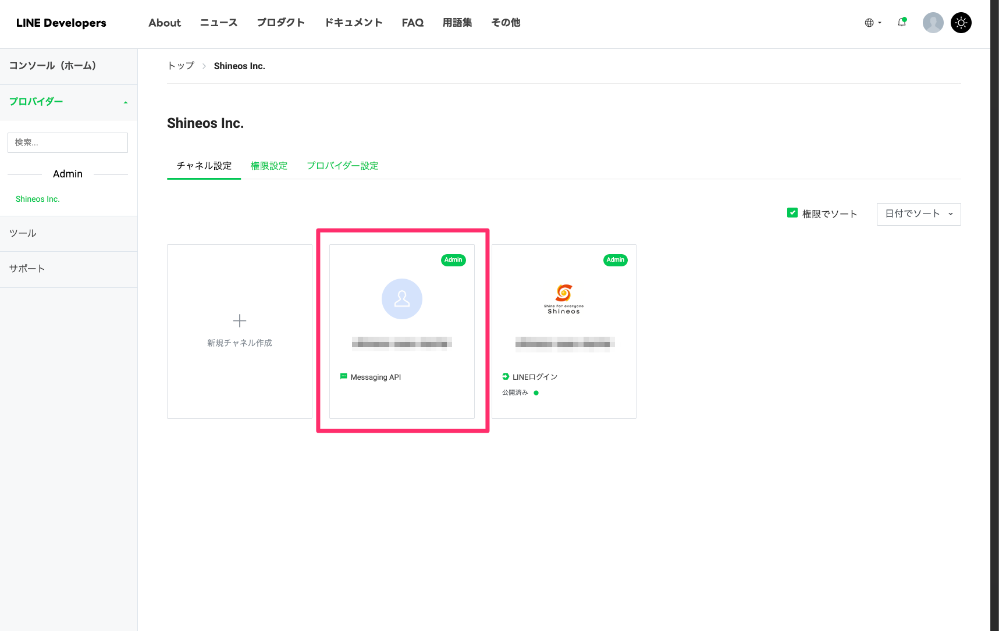
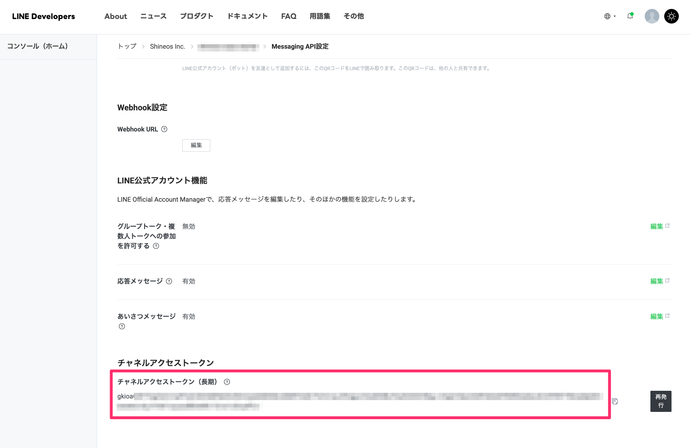
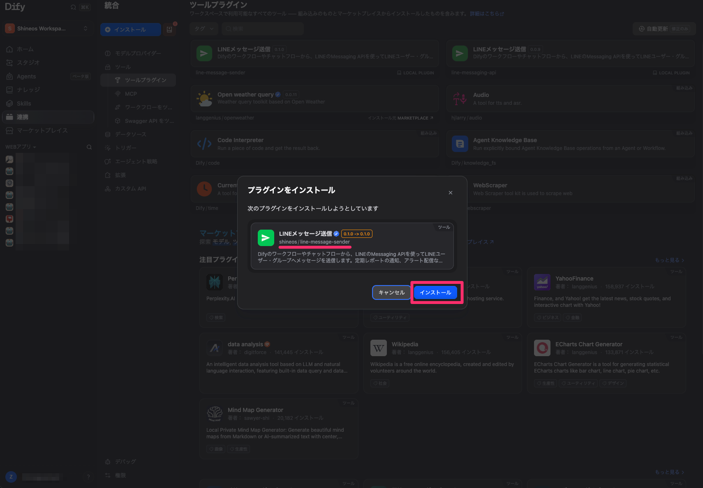
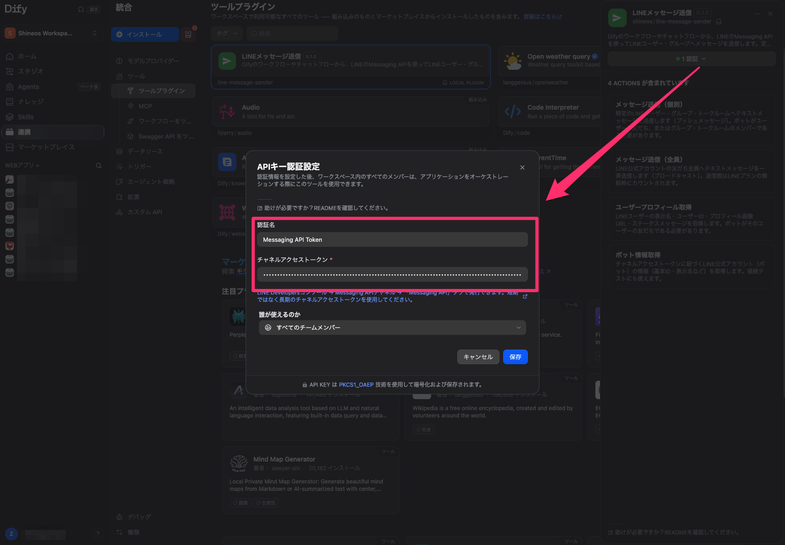
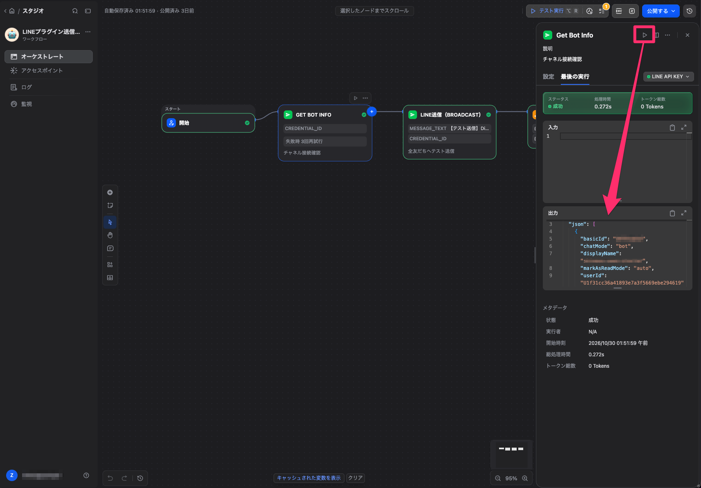

# LINE Message Sender

**Author:** shineos
**Version:** 0.2.0
**Type:** tool

[Dify](https://dify.ai) のワークフローから、[LINE Messaging API](https://developers.line.biz/ja/docs/messaging-api/overview/) を使ってLINEユーザー・グループへメッセージを送信するDifyプラグインです。

> ※[shineos](https://shineos.com) が提供するコミュニティプラグインです。LINE株式会社の公式プラグインではありません。

## 概要

本プラグインは、1つの認証情報（**チャネルアクセストークン**）だけで次の4つのツールを提供します:

- **メッセージ送信（個別）** — 特定のLINEユーザー・グループ・トークルームへテキストを送信
- **メッセージ送信（全員）** — LINE公式アカウントの友だち全員へテキストを一斉送信
- **ユーザープロフィール取得** — 表示名・ユーザーID・プロフィール画像URL・ステータスメッセージを取得
- **ボット情報取得** — 公式アカウント自身の情報を取得（接続テストに利用できます）

典型的な使い方:

- 日次レポートや監視アラート、フォーム受付通知をワークフローからLINEへ通知
- スケジュール実行（トリガー）でキャンペーン告知を友だち全員に一斉配信
- 個別返信の前にユーザープロフィールを取得してパーソナライズ

## ツール

### メッセージ送信（個別）— Send Push Message

1つの宛先へテキストメッセージを送信します。ボットがユーザーの友だち、またはグループ・トークルームのメンバーである必要があります。

| パラメータ | 型 | 必須 | 説明 |
|---|---|---|---|
| `to` | string | ○ | 宛先のLINE ID: ユーザー（`U...`）／グループ（`C...`）／トークルーム（`R...`） |
| `message_text` | string | ○ | 送信するテキスト（最大5,000文字） |
| `notification_disabled` | boolean | − | trueにすると、受信端末に通知されずに届きます |

戻り値JSON: `{"status": "sent", "to": "...", "request_id": "..."}`

### メッセージ送信（全員）— Send Broadcast Message

LINE公式アカウントの**友だち全員**へテキストメッセージを一斉送信します。宛先の指定は不要です。

| パラメータ | 型 | 必須 | 説明 |
|---|---|---|---|
| `message_text` | string | ○ | 一斉送信するテキスト（最大5,000文字） |
| `notification_disabled` | boolean | − | trueにすると、受信端末に通知されずに届きます |

戻り値JSON: `{"status": "sent", "scope": "all_friends", "request_id": "..."}`

### ユーザープロフィール取得 — Get User Profile

ユーザーのプロフィールを取得します。対象ユーザーはボットの友だちである必要があります。

| パラメータ | 型 | 必須 | 説明 |
|---|---|---|---|
| `user_id` | string | ○ | `U` で始まるLINEユーザーID |

戻り値はLINEのプロフィールJSON: `displayName`、`userId`、`pictureUrl`、`statusMessage`。

### ボット情報取得 — Get Bot Info

公式アカウント自身の情報を取得します。パラメータは不要です。セットアップ後に一度実行して、認証情報が正しく機能するか確認できます。

戻り値JSON: `userId`（ボット自身のユーザーID）、`basicId`（LINE ID、例: `@abc123`）、`displayName`、`chatMode`、`marked`。

## セットアップ手順

### ステップ1 — Messaging APIチャネルを作成する

1. [LINE Developersコンソール](https://developers.line.biz/console/) にLINEアカウントでログインします。
2. **プロバイダー**（会社名・製品名）を作成、または既存のものを選択します。
3. プロバイダー配下で、種類が **Messaging API** のチャネルを作成します。LINE公式アカウントが必要です（無料プランで開始できます）。



### ステップ2 — チャネルアクセストークン（長期）を発行する

1. 作成したチャネルを開き、**Messaging API** タブに移動します。
2. 「**チャネルアクセストークン（長期）**」までスクロールし、**「発行」** をクリックします。
3. 発行されたトークンをコピーします。基本設定タブの短期トークンではなく、必ずこの**長期**トークンを使用してください。



### ステップ3 — Difyにプラグインをインストールする

Dify Marketplace（「LINE」で検索）から **LINE Message Sender** (shineos) をインストールします。Marketplaceに接続できない場合は、[GitHubリリース](https://github.com/Shineos/dify-line-message-sender/releases) の `.difypkg` ファイルをアップロードしてインストールできます。



### ステップ4 — 認証情報を登録する

1. Difyで **ツール → LINE Message Sender → 認証する** を開きます。
2. ステップ2で発行したチャネルアクセストークンを貼り付けて保存します。



### ステップ5 — 接続をテストする

**ボット情報取得（Get Bot Info）** を一度実行します。JSON応答にアカウントの `basicId` と `displayName` が表示されれば、接続は正常です。



## 使い方

任意のワークフロー・チャットフローにツールノードを追加します:

1. **LINE Message Sender** のツールノードを追加し、4つのツールから1つを選択します。
2. パラメータを入力します（例: 個別送信なら `to` に宛先のユーザーID、`message_text` に本文）。
3. ワークフローを実行します。成功すると、ノードはLINE発の `request_id` を含むJSONを出力します。

典型的なパターンは、スケジュール実行のワークフロー（cronトリガー → データ取得/LLM要約 → **メッセージ送信（個別）**）、またはチャットフローの最後に対象ユーザーのLINEへ通知を送る構成です。

### 宛先ID（受信者ID）の調べ方

本プラグインはID指定で送信するため、受信者のLINEユーザーIDが必要です:

- **ユーザーID（`U...`）** はWebhookペイロードから取得します — 友だち追加時の `follow` イベントや、メッセージ受信の `message` イベントなど。Difyのエンドポイントプラグインを含む任意のWebhook受信機で確認できます。
- **グループ・トークルームID（`C...` / `R...`）** も同様に、ボットがそのグループ等に参加している間のWebhookイベントから取得できます。
- ボット自身のIDは **ボット情報取得（Get Bot Info）** の `userId` フィールドでいつでも確認できます。

## 注意事項

- プッシュメッセージは、ボットの**友だちになっているユーザー**、またはボットが**参加しているグループ・トークルーム**にのみ届きます。
- ブロードキャストの送信数はLINEプランの月間メッセージ無料枠にカウントされます。
- 現在対応しているのはテキストメッセージのみです（画像・Flex Messageは未対応）。
- プラグインの外部接続先は `api.line.me` のみです。

## 適正利用（Anti-abuse）

本プラグインは実在のユーザーへメッセージを送信します。利用者は送信者としての責任を負うため、以下を守ってください:

- **オプトインした相手にのみ送信する。** プッシュメッセージはボットの友だちにのみ届き、グループ・トークルームへの送信はボットがメンバーである間のみ機能します（この制限はLINE側で強制されます）。この仕組みを回避しようとしないでください。
- **一括送信（ブロードキャスト）は適切に。** ブロードキャストはLINEプランの月間メッセージ枠を消費し、アカウントの友だち全員に届きます。[LINE公式アカウントの利用規約・ガイドライン](https://terms2.line.me/official_account_api_terms/) および、商業メッセージにおける特定電子メール法を含む適用法令の遵守は利用者の責任で行ってください。
- **`notification_disabled` は慎重に使う。** サイレント配信は低優先度の業務通知（ログのダイジェスト等）のための機能であり、望まれない一括メッセージを隠すためのものではありません。
- **メッセージ本文に機微な個人情報を含めない。** 送信したメッセージは受信者のLINEトーク履歴に残ります。認証情報や機微な個人情報を本文に含めることは避けてください。
- **レート制限を考慮したワークフロー設計にする。** 同じ宛先へ1件ずつ大量送信するループは避け、集約や要約を挟んでください。LINEはAPIレート制限を設けており、乱用パターンはLINEによりチャネルの制限・停止の対象になり得ます。

## ビルドとテスト

Python 3.12が必要です。実行時・テスト時の依存関係をインストールし、オフラインのテストスイートを実行します:

```sh
python -m pip install -r requirements-dev.txt
python -m pytest tests -q
```

DifyプラグインCLIでインストール可能なパッケージをビルドするには、親ディレクトリから次を実行します:

```sh
dify plugin package ./line-message-sender
```

パッケージにはプラグインの実行に必要なファイルとドキュメントのみが含まれます。テストと開発用スクリプトは `.difyignore` によって除外されます。

## プライバシー

本プラグインの[プライバシーポリシー（英語）](https://github.com/Shineos/dify-line-message-sender/blob/main/PRIVACY.md) を参照してください。チャネルアクセストークンはDifyワークスペース内に保存され、プラグインは `api.line.me` にのみリクエストを送信します。

## 提供元

- 提供者: shineos — https://shineos.com
- ソースコード: https://github.com/Shineos/dify-line-message-sender
- LINE Messaging API リファレンス: https://developers.line.biz/ja/reference/messaging-api/
